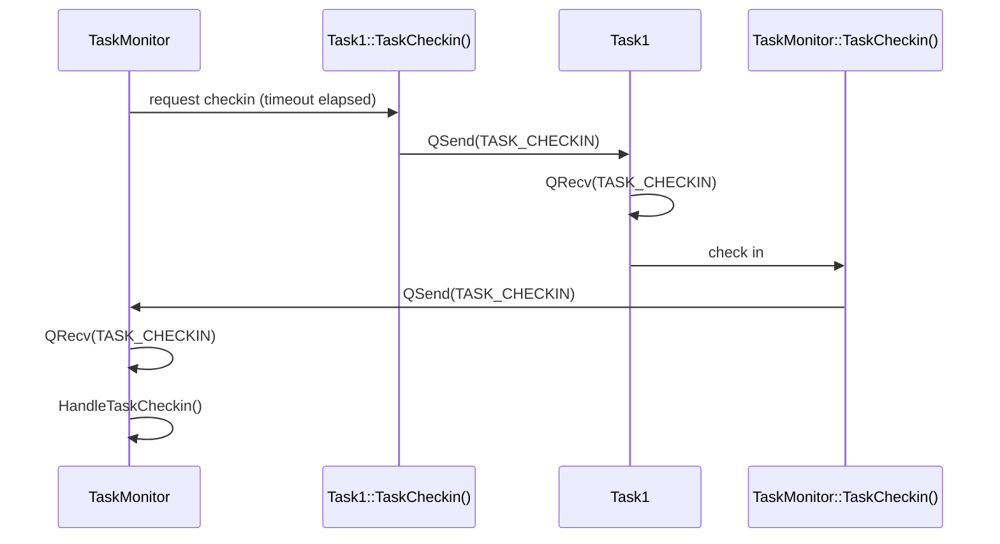

# TaskMonitor

[](https://buymeacoffee.com/ls6777)

Embedded Task Monitor

## Overview
A task monitor for embedded systems, including small microcontrollers running a lightweight RTOS (e.g. FreeRTOS). The task monitor makes sure all other tasks are running as expected. If a task stops checking in, the task monitor takes an action. The default action is to log the task's name and stop kicking the watchdog, so the device resets. This can easily be changed, e.g. to restart the task in violation.

The example application runs on an ESP32 (ESP-WROVER-KIT) with ESP-IDF, but the monitor itself is RTOS and target agnostic: all OS and target calls go through a small port layer.

## Introduction
In a multi-threaded system, a task monitor is one of the most useful components for robustness, safety and stability. It makes sure all the other tasks are working as intended. If a task stops checking in with the task monitor, the monitor detects the violation and takes an action. A very basic action is to let the watchdog time out and reset the device.

Nearly every product I've worked on has included some type of task monitor. Having improved the implementation over various projects and years of work, I felt this would be useful for the community.

## Background
Many operating systems have built-in task monitoring (e.g. Linux). Many smaller real time operating systems (e.g. FreeRTOS) don't. This implementation is intended for smaller embedded systems without that functionality.

## Features
- Monitor any number of tasks
- Each task can have its own timeout period
- The task monitor sends a checkin request to a task, and the task responds
- OR a task can check in at any time, without being asked
- The task monitor identifies the task checking in automatically (no need to track or send task IDs)
- The watchdog is managed in a single place
- Ideal for event driven and message driven tasks
- Small footprint
- RTOS and target agnostic: only the port layer (`TargetPort.hpp/.cpp`) needs changing
- At most one checkin request per timeout period per task, however quickly the responses arrive (e.g. with a 100 ms timeout, requests go out at most every 100 ms)
- An unsolicited checkin resets the timing, so no request is sent unnecessarily

## Project layout
```
CMakeLists.txt              ESP-IDF project
sdkconfig.defaults          Settings the project relies on (tick rate, task watchdog, run-time stats)
main/
  main.cpp                  Example application: creates the task monitor and example tasks
  Inc/CheckinTracker.hpp    Generic monitor logic: checkin timing, requests, violations (no RTOS/target code)
  Inc/TaskMonitor.hpp       The task monitor task (message handling, watchdog, violation action)
  Src/TaskMonitor.cpp
  Inc/TargetPort.hpp        Port layer: queues, task IDs, time, watchdog, task statistics
  Src/TargetPort.cpp        Port layer implementation for FreeRTOS on ESP-IDF
  Inc/Message.hpp           Message posted to a task's queue
  Inc/Utils.hpp             Small shared helpers
  Inc|Src/DefaultTask.*     Example: prints task list and run-time statistics, responds to checkin requests
  Inc|Src/Task1.*           Example: 10 s timeout, responds to checkin requests
  Inc|Src/Task2.*           Example: 1 s timeout, checks in unsolicited every 100 ms
  Inc|Src/Task3.*           Example: 100 ms timeout, responds to checkin requests
test/                       Host unit tests for CheckinTracker (Unity)
```

## Using the Code
Tasks only need two functions.

First, a task registers itself with the task monitor, as part of its initialization:

- The first argument is the task's timeout in ms: the maximum time the monitor waits before requesting a checkin, and then for the response.
- The second argument is the callback the task monitor calls to request a checkin from the task.

```cpp
TaskMonitor::Register(CHECKIN_TIMEOUT, &TaskCheckin);
```

The callback runs in the task monitor's task, so it must be quick and must not block. It should just notify the registering task. For example, by posting a message to the task's queue:

```cpp
void Task1::TaskCheckin()
{
    SendMessage(Message::TASK_CHECKIN);
}

void Task1::SendMessage(Message::MsgId id)
{
    const Message msg(id);
    const StatusType status = TargetPort::QSend(msgQHandle, &msg);
    ASSERT(PASS == status);
    (void)status;
}
```

When Task1 receives the `TASK_CHECKIN` message, it checks in with the task monitor. For a task without a message queue, see [Alternative checkin callback](#alternative-checkin-callback) below.

The other function checks in with the task monitor. Call it from the task that is checking in, in response to a request or at any time:

```cpp
TaskMonitor::TaskCheckin();
```

The following sequence diagram shows a requested checkin:



The task monitor sends a request to a registered task once its timeout has elapsed since its last checkin. If the task checks in before that, the timer restarts and no request is sent until another full timeout period has elapsed. After a request, the task has another full timeout period to respond, so the worst case time to detect a stuck task is twice its timeout.

### Task Monitor Task
The task monitor runs in its own task. It should be the highest priority task, and it must evaluate more than twice as fast as the shortest task timeout (it runs every 10 ms by default, see `MSG_Q_TIMEOUT` in [TaskMonitor.cpp](main/Src/TaskMonitor.cpp)).

Call `TaskMonitor::Initialize()` before creating any task that registers with it. This creates the monitor's queue, so it exists however the tasks get scheduled. Then create the task monitor task. For example, with FreeRTOS:

```cpp
static void StartTaskMonitor(void* argument)
{
    TaskMonitor taskMon;
    taskMon.Run();
}

void app_main(void)
{
    // Create the task monitor's queue before any task can register with it
    TaskMonitor::Initialize();

    xTaskCreate(&StartTaskMonitor, "TaskMonitor", TASK_MONITOR_STACK_SIZE, nullptr, TASK_MONITOR_PRIORITY, nullptr);

    // ... create the other tasks
}
```

### Alternative checkin callback
If a task doesn't use a message queue, a flag works too. Use `std::atomic`, because the callback runs in the task monitor's task:

```cpp
static std::atomic<bool> checkinRequested{false};

void Task1::TaskCheckin()
{
    checkinRequested = true;
}

void Task1::Run()
{
    // Task loop - never exits
    while (true)
    {
        if (checkinRequested.exchange(false))
        {
            TaskMonitor::TaskCheckin();
        }

        // Rest of task execution
        // ...
    }
}
```

### Violation Actions
When a task doesn't respond to a checkin request in time, the task monitor calls `OnViolation()` in [TaskMonitor.cpp](main/Src/TaskMonitor.cpp). It's called on every evaluation until the task checks in or registers again. By default it logs the first violation and the task monitor stops kicking the watchdog, so the watchdog resets the device:

```cpp
void OnViolation(TaskHandle taskId, const CheckinTracker<TaskHandle>::Info& info)
{
    if (!violationDetected)
    {
        LOG_ERROR("TaskMonitor", "Task: %s - Exceeded Checkin Time. Elapsed time %lu ms, Timeout %lu ms",
                  TargetPort::GetTaskName(taskId), (unsigned long)info.elapsedWaitingForResponse,
                  (unsigned long)info.timeout);
        violationDetected = true;
    }
}
```

The task monitor keeps processing its queue until the reset. If it just spun instead, tasks that check in often would fill its queue and fail. On the ESP32 the output looks like this:

```
E (20284) TaskMonitor: Task: Task1 - Exceeded Checkin Time. Elapsed time 10010 ms, Timeout 10000 ms
E (25273) task_wdt: Task watchdog got triggered. The following tasks/users did not reset the watchdog in time:
E (25273) task_wdt:  - TaskMonitor (CPU 0/1)
...
Rebooting...
```

Replace it with your own action if needed, e.g. restart the task in violation.

The monitor also prints the longest time each task took to respond to a request, every 30 seconds. Remove `ENABLE_TASK_MAX_CHECKIN_TIMES` in [TaskMonitor.cpp](main/Src/TaskMonitor.cpp) to turn that off.

## Porting to another RTOS or target
The monitor logic in [CheckinTracker.hpp](main/Inc/CheckinTracker.hpp) has no RTOS or target dependencies. Everything the task monitor and the example tasks need from the OS and target is in [TargetPort.hpp](main/Inc/TargetPort.hpp) and [TargetPort.cpp](main/Src/TargetPort.cpp). The functions are static members of the `TargetPort` class (e.g. `TargetPort::QSend()`). The types, constants and macros are global, so they read the same in every file:

| Item | Purpose | ESP-IDF / FreeRTOS implementation |
|---|---|---|
| `TaskHandle`, `QHandle`, `StatusType`, `PASS`, `FAIL`, `TRUE`, `FALSE`, `MAX_DELAY` | Types and constants | `TaskHandle_t`, `QueueHandle_t`, `BaseType_t`, `pdPASS`, ... |
| `CreateQ`, `QSend`, `QRecv` | Message queues | `xQueueCreate`, `xQueueSend`, `xQueueReceive` |
| `GetCurrTaskHandle`, `GetTaskName` | Identify the task checking in | `xTaskGetCurrentTaskHandle`, `pcTaskGetName` |
| `GetTimeMs`, `MS_TO_TICKS`, `DELAY` | Time | `xTaskGetTickCount`, `pdMS_TO_TICKS`, `vTaskDelay` |
| `StartWatchdog`, `WatchdogReset` | Watchdog, called only from the task monitor's task | `esp_task_wdt_add`, `esp_task_wdt_reset` |
| `ASSERT`, `LOG_ERROR` | Asserts and error logging | `assert`, `ESP_LOGE` |
| `GetTaskList`, `GetRunTimeStats` | Task statistics (DefaultTask example only) | `vTaskList`, `vTaskGetRunTimeStats` |

For example, a port to plain FreeRTOS on another target keeps the queue, task and time functions as they are and only replaces the two watchdog functions with that target's hardware watchdog driver.

The task monitor identifies tasks by `TaskHandle`, so it needs a way to get the handle of the calling task (`GetCurrTaskHandle`) and a type that can be used as a `std::map` key.

Asserts use the standard `assert()` and are meant to stay enabled, even in production builds. They can be disabled through the project configuration (NDEBUG), so no required code is ever inside an `ASSERT`.

## Building
Tested with ESP-IDF v6.1. From an ESP-IDF terminal:

```
idf.py set-target esp32
idf.py build
idf.py -p COM3 flash monitor
```

`sdkconfig.defaults` holds the settings the project relies on, so they survive `idf.py set-target` and deleting `sdkconfig`:

- `CONFIG_FREERTOS_HZ=1000`: 1 ms tick, for 10 ms evaluation and clean wrap-around of `GetTimeMs()`
- `CONFIG_ESP_TASK_WDT_PANIC=y`: the task watchdog resets the device. Without it, the watchdog only prints a warning and a violation never resets the device.
- `CONFIG_FREERTOS_USE_TRACE_FACILITY`, `..._USE_STATS_FORMATTING_FUNCTIONS`, `..._GENERATE_RUN_TIME_STATS`: task statistics printed by DefaultTask

The project includes a shared VS Code setup (`.vscode/c_cpp_properties.json` and `extensions.json`) for the ESP-IDF and C/C++ extensions. Code navigation uses `build/compile_commands.json`, so build once first.

## Unit tests
The generic monitor logic (`CheckinTracker`) has host unit tests in `test/`, using the Unity framework that ships with ESP-IDF. They need `IDF_PATH` set and a host gcc, CMake and Ninja (e.g. MinGW from WinLibs on Windows):

```
cmake -S test -B test/build -G Ninja
cmake --build test/build
ctest --test-dir test/build --output-on-failure
```

## Targets
The example application runs on an ESP32 (ESP-WROVER-KIT) with ESP-IDF and FreeRTOS. The monitor can be adapted to any other target and RTOS through the port layer (see [Porting to another RTOS or target](#porting-to-another-rtos-or-target)).
